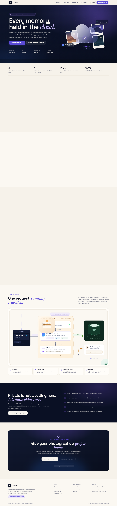
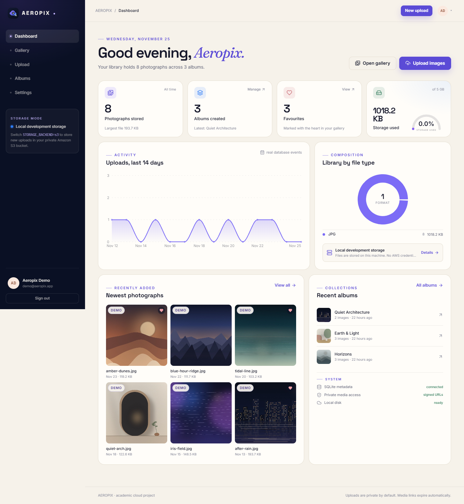
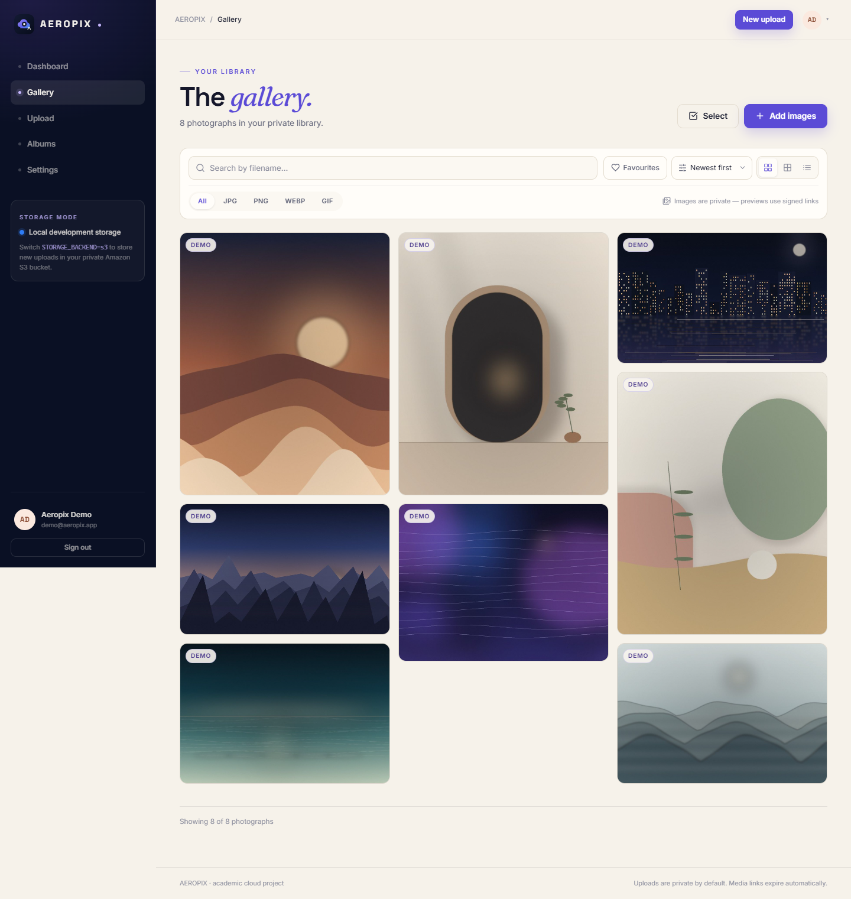
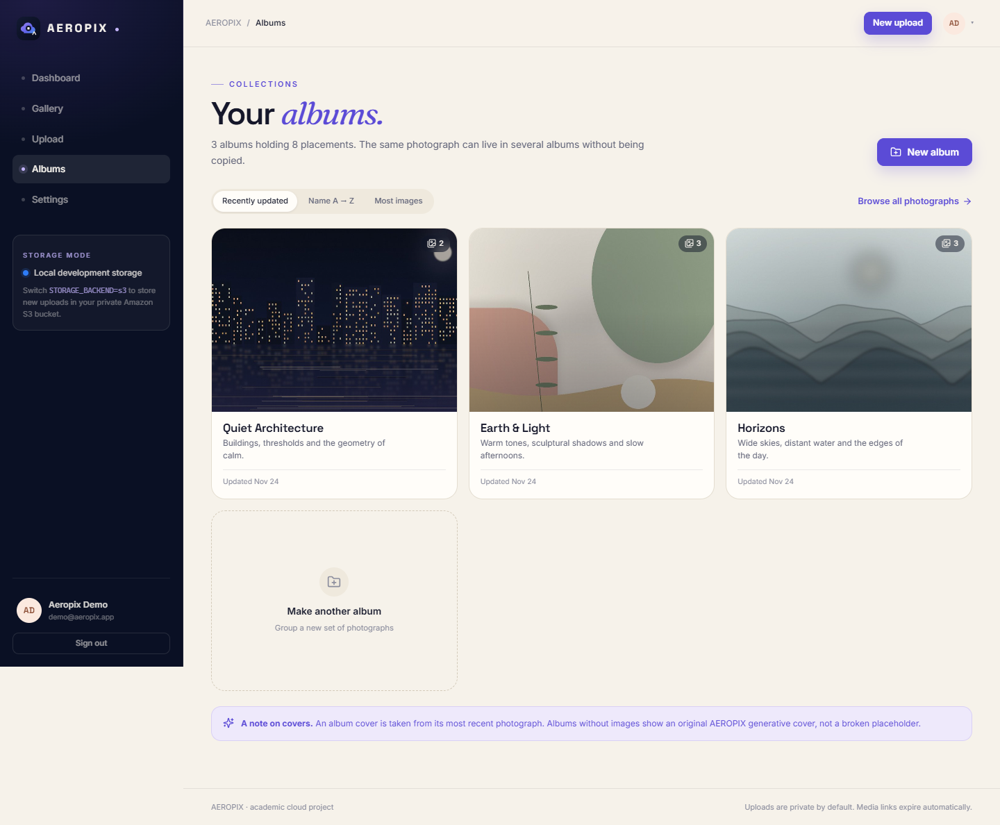
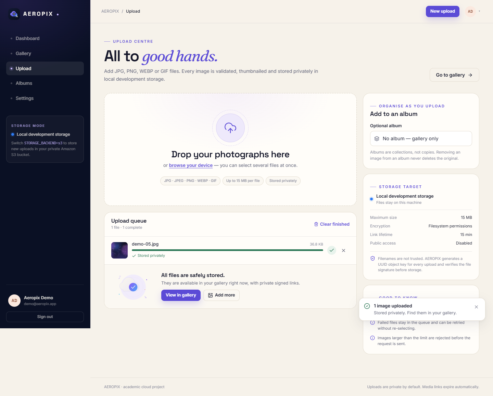
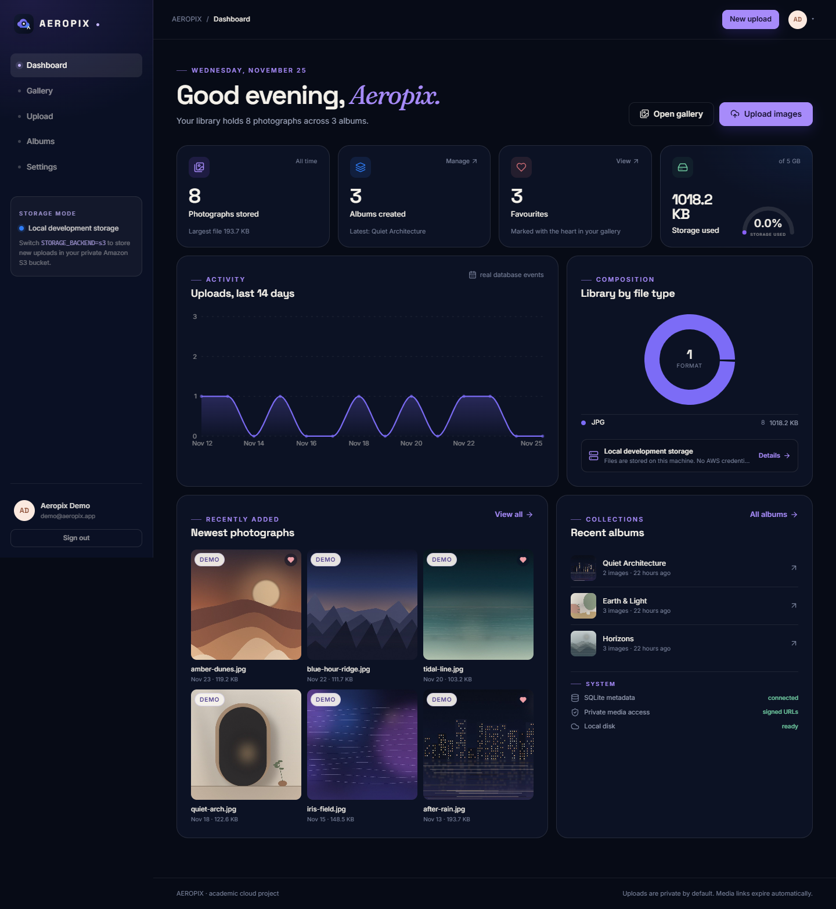
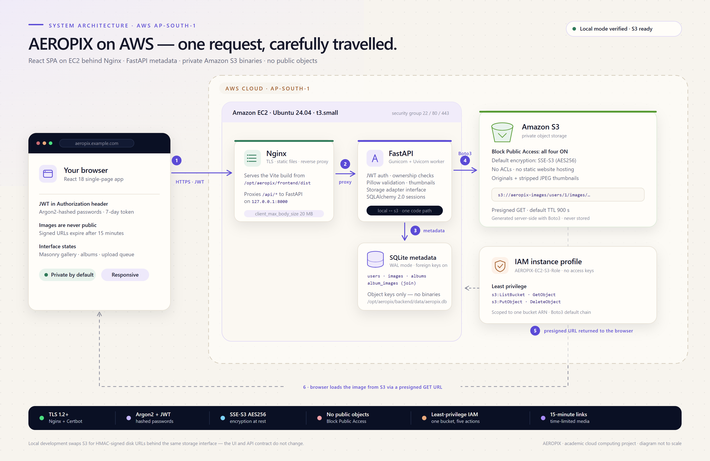

# AEROPIX

**Cloud-Based Image Storage and Gallery System**

A full-stack academic cloud computing project that stores image metadata in SQLite and image
binaries in a **private Amazon S3 bucket**, with a premium React interface, FastAPI backend,
real presigned URLs, and an EC2 + Nginx + Gunicorn deployment path.

> **Academic status:** the application, its 34 automated tests, the production frontend build
> and 18 genuine browser screenshots have been verified locally. A live AWS deployment has
> **not** been performed in this workspace because no AWS account or credentials were
> available. The repository contains the complete scripts, IAM policies and beginner-friendly
> AWS guide needed to deploy it. AWS console screenshots must be captured by the student after
> deployment — they are deliberately **not** fabricated. See
> [docs/final-checklist.md](docs/final-checklist.md).



## Why this project exists

Most student "cloud storage" projects upload files to a local folder and call it cloud. AEROPIX
implements the real thing:

* a **private S3 bucket** with Block Public Access and SSE-S3 encryption;
* **short-lived presigned GET URLs** generated server-side with Boto3;
* an **IAM instance profile** so the EC2 server never stores AWS access keys;
* a **storage abstraction** that switches between local disk and S3 without changing the API
  or the interface — which is how the project can be demonstrated without an AWS bill and then
  deployed to real cloud infrastructure with one environment variable.

## Features

| Area | What is implemented |
|---|---|
| Accounts | Register, login, logout, JWT bearer auth, Argon2 password hashing, profile edit, password change |
| Uploads | JPG / JPEG / PNG / WEBP / GIF, magic-byte validation, 15 MB limit, multi-file queue, per-file progress, retry, cancel |
| Storage | Local backend with HMAC-signed media URLs, **Amazon S3 backend** with AES256 SSE and presigned URLs |
| Gallery | Responsive masonry / grid / list views, search, type filter, favourites filter, sorting, lightbox, pagination |
| Albums | Create, rename, delete, add/remove images, automatic cover, many-to-many membership without duplicating files |
| Image detail | Large preview, metadata, favourite toggle, rename, download, delete, album membership |
| Dashboard | Recharts upload-activity area chart and storage-by-type donut, stat cards, recent uploads, quota |
| Design | Midnight navy + indigo/violet + electric blue + warm off-white, Inter / Space Grotesk / Fraunces, glass used selectively |
| UX | Light/dark/system theme, reduced-motion support, keyboard-accessible dialogs, responsive down to 360 px, custom 404 |
| Ops | Nginx reverse proxy, Gunicorn + Uvicorn, systemd hardening, security headers, health endpoint, deployment verification |

## Screenshots

All screenshots below are real captures of the production build running in a browser, using the
local storage backend. They are not mockups.

| | |
|---|---|
|  |  |
| Landing page | Dashboard with live Recharts |
|  |  |
| Masonry gallery | Albums |
|  |  |
| Successful upload through the UI | Dark theme |

The full set (18 images) is in [`docs/screenshots/`](docs/screenshots/), with the automated
check log in [`capture-report.json`](docs/screenshots/capture-report.json).

## Architecture



```text
Browser (React 18 SPA)
   │  HTTPS · JWT in Authorization header
   ▼
Nginx on EC2 ── serves /opt/aeropix/frontend/dist
   │  proxies /api/*
   ▼
Gunicorn + Uvicorn ── FastAPI
   ├── SQLite (WAL)         → users, images, albums, album_images
   └── Boto3 + IAM role     → private S3 bucket (originals + thumbnails)
                                   │
                                   └── presigned GET (15 min) → browser
```

Local mode replaces S3 with signed disk URLs behind the same `StorageBackend` interface. The
API contract, UI and tests are identical.

More: [docs/architecture.md](docs/architecture.md) · [Mermaid diagram](docs/architecture.md#mermaid-view)

## Tech stack

| Layer | Technology |
|---|---|
| Frontend | React 18, TypeScript, Vite 6, React Router 6, TanStack Query 5, Framer Motion 11, Recharts 2, Lucide |
| Styling | Hand-written CSS design system, self-hosted Inter / Space Grotesk / Fraunces (`@fontsource`) |
| Backend | FastAPI 0.115, SQLAlchemy 2.0, Pydantic v2, PyJWT, pwdlib (Argon2), Pillow, Boto3 |
| Database | SQLite 3 in WAL mode (metadata only) |
| Cloud | Amazon S3 (private, SSE-S3), Amazon EC2 (Ubuntu 24.04), IAM instance profile |
| Serving | Nginx, Gunicorn, Uvicorn worker, systemd |
| Testing | pytest, httpx, moto[S3]; Playwright-core browser checks |

## Local quick start (no AWS account needed)

**Requirements:** Python 3.11+, Node.js 20+, npm.

### Windows

```powershell
powershell -ExecutionPolicy Bypass -File scripts/setup_local.ps1

# Terminal 1
cd backend
..\.venv\Scripts\python.exe -m uvicorn app.main:app --reload --port 8000

# Terminal 2
cd frontend
npm run dev
```

### Linux / macOS

```bash
chmod +x scripts/setup_local.sh
./scripts/setup_local.sh

# Terminal 1
cd backend
../.venv/bin/python -m uvicorn app.main:app --reload --port 8000

# Terminal 2
cd frontend
npm run dev
```

Open **http://localhost:5173**.

**Demo account:** `demo@aeropix.app` / `AeropixDemo123!`

The demo library contains 8 original procedural artworks, clearly labelled **DEMO** in the
interface. No stock or AI-generated photographs are used.

## Amazon S3 mode

1. Create a **private** bucket with Block Public Access and default encryption
   ([docs/aws-setup.md](docs/aws-setup.md)).
2. Attach the least-privilege role in [`infrastructure/iam/`](infrastructure/iam/README.md) to
   the EC2 instance.
3. Set in `.env`:

```dotenv
STORAGE_BACKEND=s3
AWS_REGION=ap-south-1
AWS_BUCKET_NAME=your-private-bucket
```

4. Verify the bucket from the server:

```bash
python scripts/check_s3.py
```

No access keys are needed on EC2. For a local experiment, use an IAM user restricted to this
one bucket (never commit the keys).

## Tests

```bash
cd backend
..\.venv\Scripts\python.exe -m pytest -q
```

Verified result in this workspace:

```text
34 passed in 17.04s
```

The suite covers registration/login, JWT protection, ownership isolation, upload validation,
signed-URL tampering, favourites, search/sort, albums, bulk delete, dashboard statistics,
local-to-S3 switching, S3 round trips under `moto`, and an end-to-end upload to mocked S3.
`moto` is an AWS mock — it proves the S3 code path, **not** a live AWS deployment.

The browser verification script exercised the production build and reported **17/17 checks
passed, 0 console errors, no broken images**. See
[docs/testing-report.md](docs/testing-report.md).

## Project structure

```text
aeropix/
├── backend/
│   ├── app/
│   │   ├── models/            SQLAlchemy models
│   │   ├── routers/           auth, images, albums, dashboard, system
│   │   ├── services/          storage (local + s3), image and auth services
│   │   ├── utils/             validation, thumbnails, time
│   │   ├── config.py          typed environment settings
│   │   ├── database.py        engine, sessions, SQLite PRAGMAs
│   │   ├── demo_art.py        original procedural demo artwork
│   │   ├── seed.py            demo account seeding
│   │   └── main.py            FastAPI app, security headers, SPA serving
│   ├── tests/                 34 pytest tests
│   └── requirements*.txt
├── frontend/
│   ├── src/                   React pages, components, contexts, styles
│   ├── public/demo/           local demo image used by upload tests
│   └── scripts/               screenshot + diagram automation
├── infrastructure/
│   ├── architecture/          SVG + PNG architecture, ER and sequence diagrams
│   ├── iam/                   least-privilege policies + guide
│   ├── nginx/                 production site config
│   └── systemd/               Gunicorn service unit
├── scripts/                   setup, deploy, verify, S3 check, cleanup
└── docs/                      report, guides, testing evidence, screenshots
```

## Documentation

| Document | Purpose |
|---|---|
| [Project report](docs/project-report.md) | Full academic report with student/college placeholders |
| [Architecture](docs/architecture.md) | Components, request flows, security, Mermaid + PNG diagrams |
| [Database design](docs/database-design.md) | ER model, column definitions, indexes, deletion rules |
| [AWS setup](docs/aws-setup.md) | Beginner-friendly console walkthrough for S3, IAM, EC2, DNS, TLS, costs |
| [Deployment](docs/deployment.md) | Build, deploy, update, back up, troubleshoot |
| [Testing report](docs/testing-report.md) | Exact pytest output, browser checks, limitations |
| [User manual](docs/user-manual.md) | Every screen and workflow |
| [Screenshot checklist](docs/screenshot-checklist.md) | 18 captured screenshots + AWS evidence still required |
| [Demo script](docs/demo-script.md) | Timed viva demonstration |
| [Final checklist](docs/final-checklist.md) | Submission and security checklist |

## Security notes

* Passwords are hashed with Argon2; the plaintext is never stored.
* JWTs are sent in the `Authorization` header. Tokens live in `localStorage`, so there are no
  cookies and no CSRF surface; the trade-off (XSS exposure) is documented in the report.
* Every image and album query is scoped to the authenticated `user_id`; cross-user access
  returns 404, not 403, to avoid leaking existence.
* The S3 bucket is private. Uploaded objects are never made public and no ACLs are used.
* `.env` is git-ignored and excluded from deployment copies. No keys are committed.
* Local media URLs are HMAC-signed and expire after 15 minutes, mirroring S3 presigning.
* Nginx and FastAPI add CSP, HSTS (production), `X-Frame-Options`, `nosniff`, Referrer-Policy
  and Permissions-Policy headers.

## Credits and originality

* All interface code, SVG illustrations, diagrams and documentation were created for this
  project.
* Demo artworks are generated procedurally by `backend/app/demo_art.py` — original abstract
  compositions, not downloaded photographs.
* Fonts: Inter and Space Grotesk (SIL Open Font License), Fraunces (SIL OFL), self-hosted.
* Icons: [Lucide](https://lucide.dev) (ISC licence).
* Charts: [Recharts](https://recharts.org) (MIT).
* No Bootstrap, no component library, no emoji-based UI.

---

**Academic project submission.** Replace the placeholders in
[docs/project-report.md](docs/project-report.md) with your name, roll number, department,
college and guide before printing.
