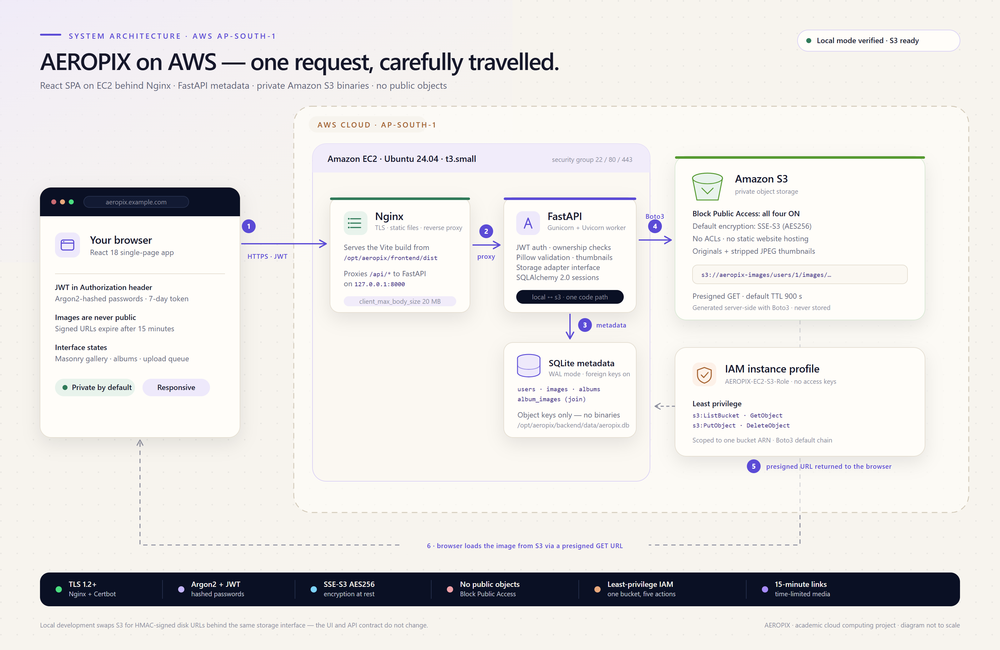
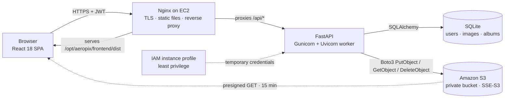
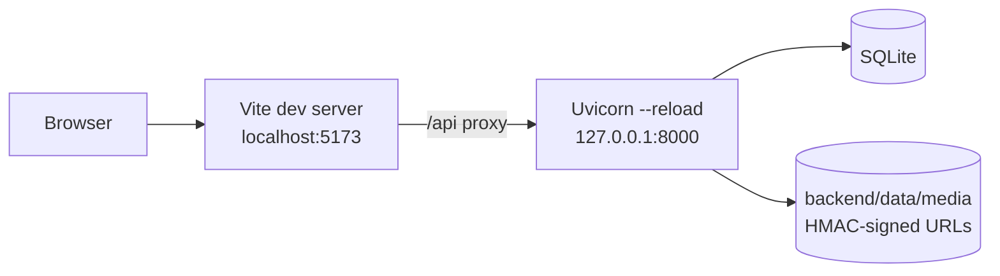
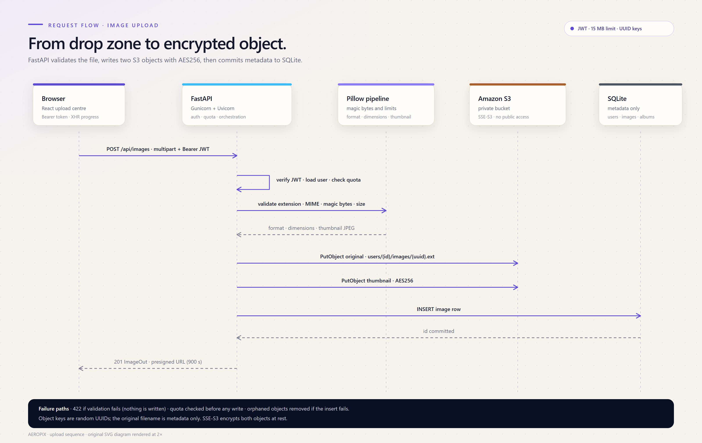
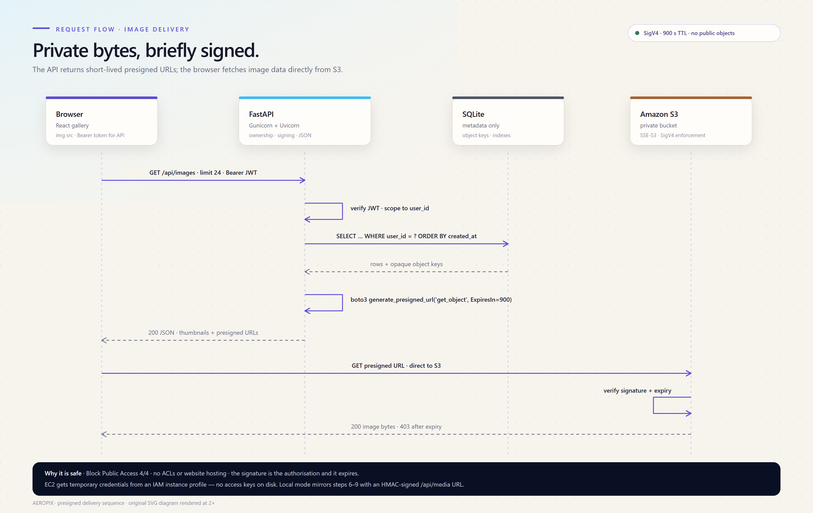

# AEROPIX — System Architecture

## 1. Design goals

AEROPIX is deliberately small enough for one student to explain, but built the way a real
cloud-backed application is built:

1. **Binary data belongs in object storage, not in the database.** SQLite stores only metadata
   and an opaque object key. Images live in Amazon S3 in cloud mode.
2. **No public objects.** The bucket blocks all public access. The browser receives short-lived
   presigned URLs, generated per request by the backend.
3. **No long-lived AWS keys on the server.** On EC2, Boto3 obtains temporary credentials from
   an IAM instance profile.
4. **One code path for local and cloud storage.** A `StorageBackend` interface lets the app run
   on a laptop with signed disk URLs, then switch to S3 with one environment variable.
5. **Ownership is enforced server-side.** Every image, album and dashboard query is filtered by
   the authenticated user.
6. **The interface should feel designed, not generated.** A custom CSS system, original SVG
   artwork, selective glass and a restrained palette replace the usual dashboard template.

## 2. Deployment topology



The editable source is
[`infrastructure/architecture/aeropix-architecture.svg`](../infrastructure/architecture/aeropix-architecture.svg);
the PNG above is rendered from it at 2× resolution.

### Mermaid view



### Local development topology



The frontend calls the same relative `/api` paths in both modes. Vite proxies them during
development; Nginx proxies them in production. No API base URL is hardcoded in the React code.

## 3. Components

| Component | Responsibility | Key files |
|---|---|---|
| React SPA | Routing, auth state, data fetching, upload queue, gallery, albums, dashboard, settings | `frontend/src/` |
| API layer | Typed fetch wrapper, token store, XHR upload with progress, error normalisation | `frontend/src/services/api.ts` |
| Nginx | TLS termination, gzip, static asset caching, SPA fallback, `/api` reverse proxy, security headers | `infrastructure/nginx/aeropix.conf` |
| Gunicorn + Uvicorn | One worker process (SQLite write safety), ASGI serving, graceful restart | `infrastructure/systemd/aeropix.service` |
| FastAPI | Routing, validation, auth dependency, exception mapping, SPA serving fallback | `backend/app/main.py` |
| Auth service | Argon2 hashing, JWT issue/verify, current-user dependency | `backend/app/services/auth_service.py`, `dependencies/authentication.py` |
| Image service | Ownership queries, storage orchestration, serialisation, quota checks | `backend/app/services/image_service.py` |
| Validators | Extension/MIME/magic-byte checks, size limit, filename sanitising, thumbnail generation | `backend/app/utils/validators.py` |
| Storage abstraction | `put`, `get`, `delete`, `exists`, `url`, `health`, `describe` | `backend/app/services/storage/` |
| Local backend | Atomic writes under `backend/data/media`, HMAC-SHA256 signed URLs | `storage/local.py` |
| S3 backend | Boto3 client, AES256 SSE, presigned GET, `head_bucket` health | `storage/s3.py` |
| SQLite | Metadata, WAL journal, foreign keys, indexes | `backend/app/database.py`, `models/` |
| Seed | Demo account + 8 original procedural artworks, idempotent | `backend/app/seed.py`, `demo_art.py` |

## 4. Request lifecycle

### 4.1 Upload



*Browser → FastAPI → Pillow → S3 → SQLite. Editable source:
[`upload-sequence.svg`](../infrastructure/architecture/upload-sequence.svg).*

```text
1. User drops files into the upload centre.
2. React validates extension and size client-side (fast feedback only).
3. XHR POST /api/images with multipart form data + Bearer token.
4. FastAPI verifies the JWT and loads the user.
5. Pillow opens the bytes, verifies the real format, enforces the 15 MB limit,
   rejects corrupt files and extension/MIME mismatches.
6. A UUID object key is built: users/{user_id}/images/{uuid}.{ext}
7. A stripped JPEG thumbnail is generated: users/{user_id}/thumbnails/{uuid}.jpg
8. The storage backend writes both objects (S3: PutObject + SSE AES256).
9. SQLAlchemy inserts the metadata row and commits.
10. The API returns the image with a fresh presigned/signed URL.
11. The UI shows the thumbnail and updates the gallery query cache.
```

If step 8 succeeds but step 9 fails, the storage service removes the orphaned objects in a
best-effort cleanup. If the browser retries, a new UUID is generated, so retries cannot
overwrite another object.

### 4.2 Viewing an image



*The API signs the URL; the browser fetches bytes directly from S3. Editable source:
[`presigned-delivery.svg`](../infrastructure/architecture/presigned-delivery.svg).*

```text
GET /api/images?limit=24&sort=newest
  → verify JWT
  → SELECT ... WHERE user_id = :current_user
  → for each row: storage.url(object_key, ttl)
      S3   → boto3 generate_presigned_url("get_object", ExpiresIn=900)
      local→ /api/media/{key}?expires=...&sig=HMAC(...)
  → JSON { items, total, has_more, ... }

Browser 
  S3   → GET https://bucket.s3.region.amazonaws.com/key?X-Amz-...
  local→ GET /api/media/key?expires&sig → signature check → FileResponse
```

The backend never proxies image bytes in S3 mode. This keeps EC2 CPU and bandwidth low and lets
S3 serve the object directly. The bucket stays private; the signature is the authorisation.

### 4.3 Delete

```text
DELETE /api/images/{id}
  → ownership query (404 if not owned)
  → delete thumbnail object
  → delete original object
  → delete album_images join rows (FK cascade)
  → delete metadata row
```

Deleting an album is different: join rows are removed, but images and objects are kept. This is
explained in [database-design.md](database-design.md).

## 5. Storage abstraction

```python
class StorageBackend(Protocol):
    name: str
    provider: str

    def put(self, key: str, data: bytes, content_type: str) -> None: ...
    def get(self, key: str) -> bytes: ...
    def delete(self, key: str) -> None: ...
    def exists(self, key: str) -> bool: ...
    def url(self, key: str, ttl_seconds: int) -> str: ...
    def health(self) -> StorageHealth: ...
    def describe(self) -> dict: ...
```

`get_storage()` is a FastAPI dependency. It reads `STORAGE_BACKEND` and returns a cached
`LocalStorage` or `S3Storage`. Routers and services never import Boto3 directly, so:

* tests can switch backends without changing application code;
* local mode works with no AWS account;
* a future CDN or MinIO backend only needs to implement the interface.

### Why local URLs are signed

A local file server that returns `/media/anything` would teach the wrong lesson: it would make
objects effectively public. Instead, local mode signs `(key, expires)` with HMAC-SHA256 using
the application secret. The media route verifies the signature and expiry before reading the
file. This mirrors S3 presigning, including the 15-minute default TTL.

## 6. Security architecture

| Threat | Control |
|---|---|
| Password theft from the database | Argon2id hashing via `pwdlib`; plaintext never stored or logged |
| Token forgery | HS256 JWT signed with a ≥24-character secret; production refuses the default secret |
| Cross-user data access | Every query includes `user_id`; unauthorised IDs return 404 |
| Public image leakage | S3 Block Public Access (all four), no ACLs, no static website hosting, presigned URLs only |
| Long-lived cloud credentials | IAM instance profile on EC2; no keys in the repo or `.env` |
| Malicious upload | Extension allowlist, MIME check, Pillow `verify()`, size limit, UUID filenames, `nosniff` |
| Path traversal (local mode) | Keys are resolved under the storage root and rejected if they escape it |
| XSS | React escaping, no `dangerouslySetInnerHTML`, CSP `script-src 'self'` |
| Clickjacking | `X-Frame-Options: DENY` and CSP `frame-ancestors 'none'` |
| MIME sniffing | `X-Content-Type-Options: nosniff` |
| CSRF | Not applicable: bearer tokens are sent explicitly, not stored in cookies |
| Brute force | Generic login error, Argon2 cost; rate limiting is listed as future work |
| Accidental public bucket | `scripts/check_s3.py` verifies Block Public Access and an unsigned GET returns 403 |

### Token storage trade-off

JWTs are kept in `localStorage` so the SPA can attach them to API and XHR requests without a
cookie/CSRF layer. The trade-off is that a successful XSS could read the token. Mitigations are
a strict CSP, React's escaping, no third-party scripts and a short 7-day expiry. For a
high-security production system, the next step would be short-lived access tokens plus
refresh tokens in `HttpOnly; Secure; SameSite=Strict` cookies.

## 7. Frontend architecture

```text
main.tsx
 └── QueryClientProvider
      └── BrowserRouter
           └── AuthProvider          (token + user, login/logout)
                └── ThemeProvider     (light/dark/system, persisted)
                     └── ToastProvider
                          └── App routes
```

* **Server state** is managed by TanStack Query. Mutations invalidate the relevant keys
  (`images`, `albums`, `dashboard`) so every screen stays consistent without a global store.
* **Auth state** is a small context. A 401 from the API clears the token and redirects to login.
* **Theme** is applied before React loads by `public/theme-init.js`, preventing a flash of the
  wrong theme. The preference is also stored on the user profile.
* **Design system** lives in `frontend/src/styles/` (`global`, `marketing`, `app`, `gallery`,
  `content`, `settings`, `responsive`). Components use semantic class names rather than utility
  soup.
* **Motion** uses Framer Motion for page/section entrances, hover lift and the lightbox. Every
  animation checks `prefers-reduced-motion`; charts disable animation when reduced motion is on.

## 8. Deployment architecture

| Layer | Choice | Reason |
|---|---|---|
| Compute | One `t3.small` EC2 instance (2 vCPU, 2 GB) | Enough for an academic demo; low cost; easy to explain |
| OS | Ubuntu 24.04 LTS | Current LTS, simple Python/Nginx packages |
| Web server | Nginx | TLS, static caching, reverse proxy, SPA fallback |
| App server | Gunicorn + 1 Uvicorn worker | ASGI support; one worker avoids SQLite write contention |
| Metadata | SQLite WAL on the instance volume | Zero-cost, adequate for a single-user demo; documented upgrade path to RDS |
| Objects | Private S3 bucket | Durable, cheap, decoupled from instance lifetime |
| Identity | IAM instance profile | No access keys on disk |
| TLS | Certbot / Let's Encrypt | Free certificates, automatic renewal |
| Process supervision | systemd | Restart on failure, boot start, hardening options |

### Scaling path

For a larger deployment:

1. Move metadata to Amazon RDS for PostgreSQL and run 2–4 Gunicorn workers.
2. Put an Application Load Balancer in front of two or more instances in an Auto Scaling group.
3. Serve images through Amazon CloudFront with signed URLs or signed cookies.
4. Move sessions/tokens to a managed identity provider if SSO is required.
5. Add rate limiting (Nginx `limit_req` or an API gateway) and structured JSON logging.

None of these changes the storage interface or the frontend contract.

## 9. Design decisions and trade-offs

| Decision | Benefit | Cost |
|---|---|---|
| SQLite instead of PostgreSQL | No database server, trivial backup, zero cost | Single-writer; one app worker; not horizontally scalable |
| S3 presigned URLs instead of proxying bytes | Lower EC2 load, direct S3 transfer | URL expiry requires refresh; clock skew must be handled |
| Bearer token in `localStorage` | Simple SPA auth, no CSRF | XSS could read the token; mitigated by CSP |
| Explicit `album_images` join model | Stores `added_at`, supports ordering and clean deletion | Slightly more code than a hidden association table |
| One Gunicorn worker | Safe SQLite writes, predictable memory | No CPU parallelism; acceptable at demo scale |
| Original procedural demo art | No licensing issues, no remote dependencies, honest labelling | Abstract rather than photographic |
| Local signed URLs | Realistic presigned-URL behaviour without AWS | Slightly more code than `StaticFiles` |

## 10. Failure handling

| Failure | Behaviour |
|---|---|
| S3 unreachable during upload | 503 with a readable message; metadata is not written; UI offers retry |
| S3 credentials missing | Startup logs a clear warning; storage health reports `reachable: false` |
| Invalid/corrupt image | 422 with a specific reason; nothing is stored |
| Expired media URL | 403; the UI refetches the image list to obtain a fresh URL |
| Duplicate album name | 409 with a friendly message (unique constraint per user) |
| Expired JWT | 401; the API client clears the session and redirects to login |
| Database locked | WAL + one worker minimise contention; requests retry through SQLAlchemy pooling |
| Frontend route refresh | Nginx `try_files ... /index.html` (and FastAPI SPA fallback in single-origin mode) |

## 11. Accessibility and responsiveness

* Semantic landmarks, labelled form controls, visible focus rings.
* Dialogs close with `Escape`, trap focus and restore focus to the trigger.
* Colour contrast targets WCAG AA for body text in both themes.
* `prefers-reduced-motion` disables page transitions, hover lift and chart animation.
* Layout breakpoints cover 360 px phones, tablets, laptops and wide desktops.
* Images have meaningful `alt` text; decorative SVG illustrations are `aria-hidden`.
* Toasts use `role="status"`; errors are announced without stealing focus.

## 12. What is verified — and what is not

**Verified locally**

* Production frontend build served by Vite preview with the real FastAPI backend.
* 34 backend tests passing, including mocked S3 round trips and backend switching.
* 17 browser checks passing with 0 console errors and no broken images.
* 18 genuine screenshots of the running application.
* S3 integration code, IAM policies, Nginx and systemd configuration reviewed statically.

**Not verified in this workspace**

* A live AWS deployment (no account/credentials).
* Real S3 latency, presigned URL clock behaviour and bucket policy enforcement against AWS.
* TLS issuance through Certbot and DNS propagation.

These are honest gaps, documented again in [testing-report.md](testing-report.md) and
[final-checklist.md](final-checklist.md).
