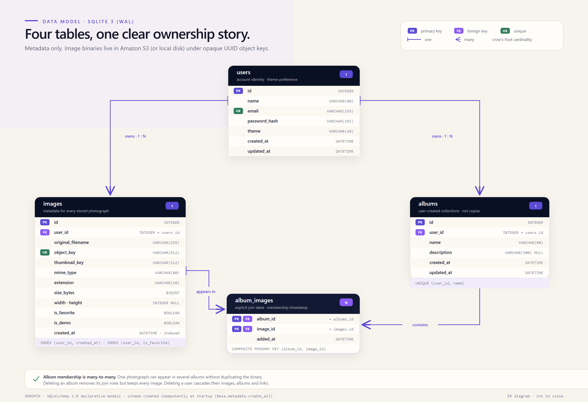
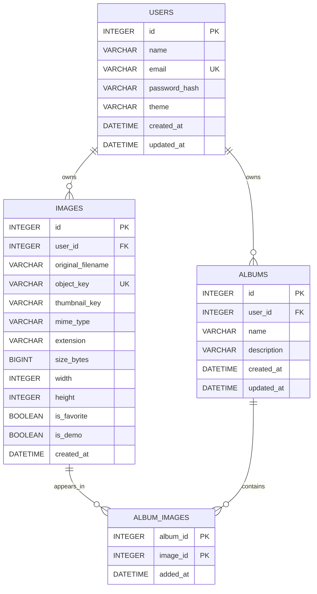

# AEROPIX — Database Design

## 1. Purpose and scope

SQLite stores **metadata only**. Image binaries never enter the database. Each row points to an
opaque object key in Amazon S3 (or the local storage directory), and the storage backend turns
that key into a temporary URL on demand.

This separation keeps the database small, makes backups fast, and matches how production
systems separate relational metadata from object storage.

## 2. Entity-relationship diagram



Editable source:
[`infrastructure/architecture/er-diagram.svg`](../infrastructure/architecture/er-diagram.svg).

### Mermaid view



## 3. Tables

### 3.1 `users`

| Column | Type | Constraints | Notes |
|---|---|---|---|
| `id` | INTEGER | PK, autoincrement | |
| `name` | VARCHAR(80) | NOT NULL | Display name, 2–80 characters |
| `email` | VARCHAR(255) | NOT NULL, UNIQUE, indexed | Normalised to lowercase |
| `password_hash` | VARCHAR(255) | NOT NULL | Argon2id hash; never returned by the API |
| `theme` | VARCHAR(10) | NOT NULL, default `system` | `light`, `dark` or `system` |
| `created_at` | DATETIME | NOT NULL | UTC |
| `updated_at` | DATETIME | NOT NULL | UTC, updated on profile change |

### 3.2 `images`

| Column | Type | Constraints | Notes |
|---|---|---|---|
| `id` | INTEGER | PK | |
| `user_id` | INTEGER | FK → `users.id` ON DELETE CASCADE, indexed | Owner |
| `original_filename` | VARCHAR(255) | NOT NULL | Sanitised for display; original extension preserved |
| `object_key` | VARCHAR(512) | NOT NULL, UNIQUE | e.g. `users/1/images/3f2c….jpg` |
| `thumbnail_key` | VARCHAR(512) | NULL | Stripped JPEG, max 720 px |
| `mime_type` | VARCHAR(80) | NOT NULL | Detected by Pillow, not trusted from the client |
| `extension` | VARCHAR(10) | NOT NULL | Lowercase: `jpg`, `jpeg`, `png`, `webp`, `gif` |
| `size_bytes` | BIGINT | NOT NULL | Original byte size |
| `width` | INTEGER | NULL | Pixel width |
| `height` | INTEGER | NULL | Pixel height |
| `is_favorite` | BOOLEAN | NOT NULL, default false | Toggle from gallery/detail |
| `is_demo` | BOOLEAN | NOT NULL, default false | Shows the DEMO badge; seed cleanup uses it |
| `created_at` | DATETIME | NOT NULL, indexed | UTC upload time |

Indexes:

```sql
CREATE INDEX ix_images_user_created  ON images (user_id, created_at);
CREATE INDEX ix_images_user_favorite ON images (user_id, is_favorite);
CREATE UNIQUE INDEX ix_images_object_key ON images (object_key);
```

The composite indexes match the gallery's dominant query:
`WHERE user_id = ? ORDER BY created_at DESC` and the favourites filter.

### 3.3 `albums`

| Column | Type | Constraints | Notes |
|---|---|---|---|
| `id` | INTEGER | PK | |
| `user_id` | INTEGER | FK → `users.id` ON DELETE CASCADE, indexed | Owner |
| `name` | VARCHAR(80) | NOT NULL | |
| `description` | VARCHAR(500) | NULL | Optional |
| `created_at` | DATETIME | NOT NULL | UTC |
| `updated_at` | DATETIME | NOT NULL | UTC |

```sql
CONSTRAINT uq_albums_user_name UNIQUE (user_id, name)
CREATE INDEX ix_albums_user_created ON albums (user_id, created_at);
```

Two different users may both have an album called "Travel"; one user cannot have two.

### 3.4 `album_images`

Explicit join table rather than a hidden many-to-many association, because the membership time
is useful for ordering and for the album detail screen.

| Column | Type | Constraints | Notes |
|---|---|---|---|
| `album_id` | INTEGER | PK, FK → `albums.id` ON DELETE CASCADE | |
| `image_id` | INTEGER | PK, FK → `images.id` ON DELETE CASCADE, indexed | |
| `added_at` | DATETIME | NOT NULL | UTC |

Composite primary key: `(album_id, image_id)` — an image can appear in an album only once, but
in any number of albums.

## 4. Relationships and cardinality

| Relationship | Cardinality | Meaning |
|---|---|---|
| `users` → `images` | 1 : N | A user owns many images; an image has exactly one owner |
| `users` → `albums` | 1 : N | A user owns many albums |
| `albums` ↔ `images` | M : N via `album_images` | An image can belong to several albums without copying the binary |

## 5. Deletion semantics

| Action | Effect |
|---|---|
| Delete an **image** | Storage objects (original + thumbnail) deleted first, then the metadata row; `album_images` rows cascade |
| Delete an **album** | Only the album and its join rows are deleted. **Images are kept**, including their S3 objects |
| Delete a **user** | Cascades images, albums and join rows. A production system would also enqueue object deletion; the current app does not expose account deletion |
| Remove an image from an album | Deletes one join row; the image and object remain |
| Delete demo data (`python -m app.seed --reset`) | Removes demo metadata and demo objects only, identified by `is_demo = 1` |

The album rule is deliberate: an album is a view over a library, not a folder that owns files.

## 6. Storage key layout

```text
users/{user_id}/images/{uuid}.{ext}          original
users/{user_id}/thumbnails/{uuid}.jpg        stripped thumbnail
```

Properties:

* The user id in the key is **not** used for authorisation; ownership is enforced in SQL. It
  merely groups objects for lifecycle rules and debugging.
* UUIDs prevent collisions and stop the original filename from leaking into a public URL.
* A configurable `S3_KEY_PREFIX` can add an environment prefix, e.g. `prod/`.
* Keys are validated before local file access so `../` cannot escape the storage root.

## 7. Representative queries

### Gallery page, newest first

```sql
SELECT *
FROM images
WHERE user_id = :user_id
ORDER BY created_at DESC
LIMIT :limit OFFSET :offset;
```

### Search by filename, filtered by type and favourites

```sql
SELECT *
FROM images
WHERE user_id = :user_id
  AND original_filename LIKE :pattern ESCAPE '\'
  AND extension IN ('jpg', 'png')
  AND is_favorite = 1
ORDER BY created_at DESC;
```

The API escapes `%` and `_` in user input before building the `LIKE` pattern.

### Dashboard totals

```sql
SELECT COUNT(*) AS total_images,
       COALESCE(SUM(size_bytes), 0) AS storage_used_bytes,
       SUM(CASE WHEN is_favorite THEN 1 ELSE 0 END) AS total_favorites
FROM images
WHERE user_id = :user_id;
```

### Album detail with cover

```sql
SELECT i.*
FROM images i
JOIN album_images ai ON ai.image_id = i.id
WHERE ai.album_id = :album_id
  AND i.user_id = :user_id
ORDER BY ai.added_at DESC;
```

### Uploads per day (last 14 days)

```sql
SELECT DATE(created_at) AS day, COUNT(*) AS uploads
FROM images
WHERE user_id = :user_id
  AND created_at >= :since
GROUP BY DATE(created_at)
ORDER BY day;
```

## 8. Integrity and concurrency

SQLite is configured with:

```sql
PRAGMA journal_mode = WAL;
PRAGMA foreign_keys = ON;
PRAGMA synchronous = NORMAL;
```

* **WAL** allows readers during a write and reduces `database is locked` errors.
* **Foreign keys** are off by default in SQLite and must be enabled per connection; the app
  does so through a SQLAlchemy connection event.
* **One Gunicorn worker** is deliberate. Multiple processes writing to the same SQLite file
  increase contention; the documented upgrade path is PostgreSQL + multiple workers.
* Each request uses a scoped SQLAlchemy session that is closed in a dependency finaliser.
* Uploads perform storage writes before the metadata commit, then clean up on failure.

## 9. Schema creation and migrations

The schema is created idempotently at startup with
`Base.metadata.create_all(bind=engine)`. This is adequate for a fresh academic deployment.

It is **not** a migration system. If columns change after data exists, add Alembic:

```bash
pip install alembic
alembic init migrations
alembic revision --autogenerate -m "describe change"
alembic upgrade head
```

Alembic is listed as future work in the project report.

## 10. Backup and restore

### SQLite metadata

```bash
# Safe copy while the service is running (WAL-aware):
sqlite3 /opt/aeropix/backend/data/aeropix.db ".backup '/tmp/aeropix-$(date +%F).db'"

# Restore:
sudo systemctl stop aeropix
cp /tmp/aeropix-2026-11-25.db /opt/aeropix/backend/data/aeropix.db
sudo chown aeropix:www-data /opt/aeropix/backend/data/aeropix.db
sudo systemctl start aeropix
```

### S3 objects

Enable bucket versioning (recommended in the AWS guide). For a full offsite copy:

```bash
aws s3 sync s3://your-bucket s3://your-backup-bucket --delete
```

### Consistency

The database and the bucket are separate stores. A metadata backup without the corresponding
objects is incomplete, and vice versa. For this project, the simplest consistent backup is:
stop the service, copy the SQLite file, then run `aws s3 sync`. Document the timestamp of both.

## 11. Why not store images as BLOBs?

| BLOB in SQLite | Object storage |
|---|---|
| Database grows to gigabytes, slow backups | Metadata stays small; objects scale independently |
| Every image consumes database page cache | S3 handles durability and throughput |
| Hard to serve directly to browsers | Presigned URLs let the browser fetch from S3 |
| No lifecycle/versioning policies | S3 lifecycle, versioning and replication available |
| Academic only | Matches real cloud architecture |

The project's purpose is to demonstrate cloud object storage, so BLOBs would defeat the point.
