# AEROPIX — Cloud-Based Image Storage and Gallery System

## Project Report

**Submitted in partial fulfilment of the requirements for the award of the degree of**

**[Bachelor of Technology / Bachelor of Computer Applications / Master of Computer Applications]**

---

| | |
|---|---|
| **Student name** | [Student Full Name] |
| **Roll / register number** | [Roll Number] |
| **Programme** | [Programme] |
| **Department** | [Department of Computer Science and Engineering] |
| **College** | [College Name] |
| **University** | [University Name] |
| **Project guide** | [Guide Name and Designation] |
| **Academic year** | [Academic Year] |

---

## Declaration

I hereby declare that the project report entitled **"AEROPIX — Cloud-Based Image Storage and
Gallery System"** is my own work, carried out under the guidance of [Guide Name]. The code,
diagrams, screenshots and documentation in this submission were produced for this project.
Sources of information and third-party libraries are acknowledged in the References section.
This work has not been submitted for any other degree or examination.

Place: [City]  
Date: [Date]

**[Student Full Name]**  
[Roll Number]

---

## Certificate

This is to certify that the project report entitled **"AEROPIX — Cloud-Based Image Storage and
Gallery System"** submitted by **[Student Full Name]** ([Roll Number]) is a record of bona fide
work carried out under my supervision and guidance, in partial fulfilment of the requirements
for the award of the degree of [Programme].

| | |
|---|---|
| **Guide** | [Guide Name] |
| **Head of Department** | [HOD Name] |
| **External examiner** | [Examiner Name] |
| **Date of examination** | [Date] |

---

## Acknowledgements

I thank [Guide Name] for guidance throughout the project, [HOD Name] and the faculty of the
[Department] for their support, and my family and friends for their encouragement. I also
acknowledge the open-source communities behind FastAPI, React, SQLAlchemy, Boto3, Pillow,
Recharts and the other libraries listed in the References.

---

## Abstract

Cloud storage has become the default way to preserve personal photographs, yet many student
projects only simulate it: files are written to a local folder and labelled "cloud". This
project designs and implements **AEROPIX**, a cloud-based image storage and gallery system that
uses **Amazon Simple Storage Service (S3)** as a private object store, **FastAPI** as the
backend, **React** as the frontend and **SQLite** for metadata.

The system separates metadata from binaries. Users, images, albums and album-image memberships
are stored relationally; image bytes and generated thumbnails are stored as objects under
opaque UUID keys. The S3 bucket blocks all public access and encrypts objects with SSE-S3.
Authorised browsers receive short-lived presigned GET URLs generated server-side with Boto3.
On EC2, Boto3 obtains temporary credentials from a least-privilege IAM instance profile, so no
long-lived AWS access keys exist on the server. A storage abstraction allows the same
application to run in a local mode with HMAC-signed disk URLs when no AWS account is available.

The web application provides registration and JWT authentication, multi-file uploads with
validation and progress, a responsive masonry gallery with search and filters, albums with
many-to-many membership, favourites, a statistics dashboard, profile settings and light/dark
themes. The interface is built with a custom design system and original SVG artwork rather than
a generic component library.

The backend test suite contains **34 automated tests**, all passing in **17.04 s**, including
upload validation, ownership isolation, signed-URL tampering, album semantics and S3 round
trips against a mocked S3 service. A real-browser verification of the production build passed
**17/17 checks with zero console errors** and produced 18 genuine screenshots. The S3 code path
and deployment configuration are complete, but a live AWS deployment was not possible in the
development environment because no AWS account or credentials were available; the report
clearly distinguishes verified local results from the deployment procedure the student must
execute and evidence afterwards.

**Keywords:** cloud storage, Amazon S3, presigned URLs, FastAPI, React, JWT, IAM, EC2, image
gallery, object storage.

---

## Table of contents

1. Introduction
2. Literature and technology review
3. System analysis
4. System design
5. Implementation
6. Cloud deployment design
7. Testing and validation
8. Results and discussion
9. Conclusion and future work
- References
- Appendix A — API endpoints
- Appendix B — Environment variables
- Appendix C — Academic integrity and evidence status

---

## List of figures

| Figure | Title |
|---|---|
| 4.1 | AWS deployment architecture |
| 4.2 | Entity-relationship diagram |
| 4.3 | Upload request sequence |
| 4.4 | Presigned image delivery |
| 5.1 | Landing page |
| 5.2 | Dashboard |
| 5.3 | Masonry gallery |
| 5.4 | Upload centre |
| 5.5 | Albums |
| 5.6 | Image detail |
| 5.7 | Settings |
| 5.8 | Dark theme |
| 5.9 | Mobile layout |

## List of tables

| Table | Title |
|---|---|
| 3.1 | Functional requirements |
| 3.2 | Non-functional requirements |
| 4.1 | Database tables |
| 4.2 | Storage key layout |
| 6.1 | AWS resources |
| 6.2 | IAM permissions |
| 7.1 | Automated test groups |
| 7.2 | Browser verification checks |
| 7.3 | Requirements traceability |

---

# 1. Introduction

## 1.1 Background

Digital photography produces large volumes of binary data. Traditional web applications often
store images on the same server as the application, which couples storage capacity to compute,
complicates backups and makes horizontal scaling difficult. Cloud object storage solves these
problems: objects are durable, replicated, accessed over HTTPS and governed by fine-grained
identity policies. Amazon S3 is the most widely used implementation.

However, object storage introduces a security question. A bucket configured for public read is
easy to demo but exposes every uploaded file to the internet. A realistic system keeps the
bucket private and grants temporary, signed access. Implementing that correctly — with
ownership checks, expiring URLs, encryption and least-privilege identity — is the educational
core of this project.

## 1.2 Problem statement

Build a web application that:

1. lets users register, authenticate and manage a personal image library;
2. stores image binaries in **private Amazon S3**, not on the web server;
3. displays images securely using time-limited URLs;
4. enforces ownership on every operation;
5. provides a polished gallery, album and dashboard experience;
6. can be deployed to a single EC2 instance behind Nginx;
7. remains demonstrable without an AWS account through a documented local mode.

## 1.3 Objectives

* Implement a typed FastAPI backend with SQLAlchemy models for users, images, albums and album
  memberships.
* Integrate Boto3 with S3 for upload, delete, health checks and presigned URL generation.
* Keep the bucket private: Block Public Access, SSE-S3, no ACLs, no static website hosting.
* Use an IAM instance profile on EC2 instead of stored access keys.
* Build a responsive React interface with a distinctive visual identity.
* Validate uploads by extension, MIME type, magic bytes and size; generate thumbnails.
* Provide automated tests for authentication, authorisation, storage and business rules.
* Document deployment, verification, operation and teardown so another student can reproduce it.

## 1.4 Scope

**Included:** single-instance deployment, SQLite metadata, S3 object storage, local fallback,
JWT auth, image CRUD, albums, favourites, dashboard, settings, light/dark themes, documentation
and tests.

**Excluded:** multi-tenant organisations, social sharing, comments, image editing, video,
mobile native apps, payments, CDN, PostgreSQL/RDS, auto-scaling and a full migration framework.
These are listed as future work.

## 1.5 Report organisation

Chapter 2 reviews the technologies. Chapter 3 analyses requirements and feasibility. Chapter 4
presents the architecture and data model. Chapter 5 describes implementation. Chapter 6 covers
the AWS deployment design. Chapter 7 reports testing. Chapter 8 discusses results, and Chapter 9
concludes.

---

# 2. Literature and technology review

## 2.1 Cloud service models

Infrastructure as a Service (IaaS) provides virtual machines and networks; Platform as a
Service (PaaS) provides managed runtimes; Software as a Service (SaaS) provides finished
applications. Object storage is usually classified as a PaaS/storage service. AEROPIX uses IaaS
(EC2) for compute and a managed storage service (S3) for binaries, which is a common hybrid
pattern for small applications.

## 2.2 Amazon S3

S3 stores objects in buckets. An object is identified by a key and has metadata, a version and
a storage class. Key properties used here:

* **Durability and availability** through managed replication.
* **Private-by-default access** combined with Block Public Access.
* **Server-side encryption** (SSE-S3/AES256) applied on upload.
* **Presigned URLs**: a time-limited URL signed with the credentials of an authorised principal.
* **IAM policies** that scope actions to one bucket and a small set of operations.

Presigned URLs solve the delivery problem without making objects public: the backend signs a
GET request, the browser uses it directly, and S3 rejects the URL after expiry.

## 2.3 FastAPI and SQLAlchemy

FastAPI is an ASGI framework built on Starlette and Pydantic. It provides request validation,
dependency injection, automatic OpenAPI documentation and async support. SQLAlchemy 2.0 offers
typed ORM models and explicit session control. For this project, synchronous SQLAlchemy with
SQLite is sufficient and keeps the code readable.

## 2.4 React and TanStack Query

React's component model suits a stateful gallery. TanStack Query separates server state
(caching, refetching, invalidation) from UI state, which avoids a large global store. React
Router provides nested application routes and a custom 404 page.

## 2.5 Authentication

Passwords are hashed with Argon2id, the winner of the Password Hashing Competition, via
`pwdlib`. Authentication issues a signed JWT containing the user id and expiry. The token is
sent in the `Authorization: Bearer` header. Because cookies are not used, CSRF does not apply;
the trade-off is that the token must be protected from XSS, which is addressed with a strict
Content Security Policy and React's escaping.

## 2.6 Related work

Commercial galleries (Google Photos, Flickr) and self-hosted tools (PhotoPrism, Immich) offer
far more features. This project does not attempt to compete on features; it isolates the cloud
storage pattern — private bucket, presigned access, least-privilege identity, metadata/binary
separation — and presents it in a compact, explainable codebase suitable for assessment.

---

# 3. System analysis

## 3.1 Existing system

A typical student implementation stores uploads in `static/uploads`, serves them with a public
URL, keeps no ownership checks beyond the UI, and runs everything on one machine with no cloud
service. Problems:

* images are publicly guessable and permanently accessible;
* storage is tied to the application server and lost if the instance is terminated;
* no separation between metadata and binaries;
* no identity or bucket policy design;
* tests often mock the storage layer entirely, so integration mistakes go unnoticed.

## 3.2 Proposed system

AEROPIX separates concerns:

* **React SPA** for presentation and interaction.
* **FastAPI** for validation, authorisation and orchestration.
* **SQLite** for relational metadata.
* **Storage adapter** with two implementations: local signed disk storage and Amazon S3.
* **Nginx** for TLS, static assets and reverse proxying.
* **IAM instance profile** for temporary AWS credentials.
* **Presigned URLs** for private image delivery.

## 3.3 Functional requirements

| ID | Requirement | Priority |
|---|---|---|
| FR-01 | Register with name, email and strong password | Must |
| FR-02 | Log in and receive a JWT; log out | Must |
| FR-03 | View and edit profile; change password | Must |
| FR-04 | Upload one or many JPG/JPEG/PNG/WEBP/GIF files | Must |
| FR-05 | Validate type, magic bytes, corruption and size | Must |
| FR-06 | Show per-file upload progress and allow retry | Should |
| FR-07 | Browse images in masonry, grid and list views | Must |
| FR-08 | Search, filter by type/favourite and sort | Must |
| FR-09 | Open a lightbox and an image detail page | Must |
| FR-10 | Rename, favourite, download and delete an image | Must |
| FR-11 | Create, rename and delete albums | Must |
| FR-12 | Add and remove images from albums | Must |
| FR-13 | Deleting an album must not delete its images | Must |
| FR-14 | Dashboard totals, activity chart and storage breakdown | Should |
| FR-15 | Switch light/dark/system theme | Should |
| FR-16 | Store binaries in private S3 and serve via presigned URLs | Must |
| FR-17 | Run without AWS using local signed storage | Must |
| FR-18 | Expose health and storage status | Should |
| FR-19 | Provide a custom 404 page | Could |
| FR-20 | Seed an honest, labelled demo library | Should |

## 3.4 Non-functional requirements

| ID | Requirement |
|---|---|
| NFR-01 | Responsive from 360 px to wide desktop |
| NFR-02 | Accessible: labels, focus states, keyboard dialogs, reduced motion |
| NFR-03 | Passwords never stored or logged in plaintext |
| NFR-04 | Every image/album query scoped to the authenticated user |
| NFR-05 | S3 bucket private; no public objects or ACLs |
| NFR-06 | No long-lived AWS credentials on EC2 |
| NFR-07 | Upload limit 15 MB; clear errors |
| NFR-08 | API responses use consistent JSON errors |
| NFR-09 | Deployment reproducible with scripts and documentation |
| NFR-10 | Automated tests must run without AWS credentials |

## 3.5 Feasibility study

**Technical.** All components are open source and run on a 2 GB instance. The developer is
familiar with Python and JavaScript. S3 and EC2 are documented and available in the AWS Free
Tier (with caveats).

**Economic.** Local development costs nothing. A short AWS demo costs a few rupees/dollars if
the instance and bucket are removed afterwards; a cost table is provided in the AWS guide.

**Operational.** One instance and one bucket are simple to operate. SQLite avoids a database
server. systemd restarts the app; Nginx handles TLS. The main operational risk — forgetting to
stop resources — is addressed by the cleanup script and checklist.

**Schedule.** The project is divisible into backend, frontend, cloud integration, testing and
documentation phases, each independently verifiable.

## 3.6 Development environment

| Item | Value |
|---|---|
| Operating system | Windows 11 (development), Ubuntu 24.04 target |
| Python | 3.11+ (virtual environment at `.venv`) |
| Node.js | 20+ |
| Browser | Google Chrome (screenshot and browser checks) |
| Backend URL | `http://127.0.0.1:8000` |
| Frontend dev URL | `http://localhost:5173` |
| Production preview | `http://localhost:4173` |

---

# 4. System design

## 4.1 Architecture

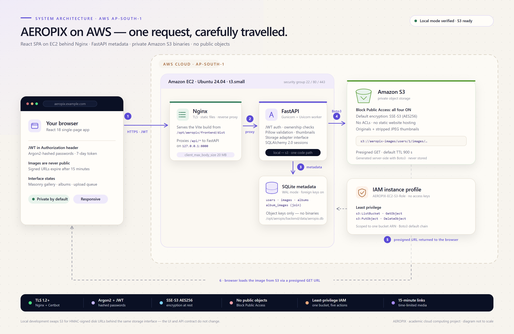

*Figure 4.1 — Browser → Nginx → FastAPI → SQLite/S3, with an IAM instance profile.*

The browser loads the React build from Nginx. API calls go to `/api/*`, which Nginx proxies to
Gunicorn/Uvicorn on `127.0.0.1:8000`. FastAPI reads/writes metadata in SQLite and binaries in
S3 through Boto3. The IAM role supplies temporary credentials. Image URLs returned by the API
are presigned S3 URLs; the browser fetches the bytes directly from S3.

In local mode, the same FastAPI process writes to `backend/data/media` and returns HMAC-signed
`/api/media/...` URLs. No frontend code changes.

## 4.2 Request flow

### Upload

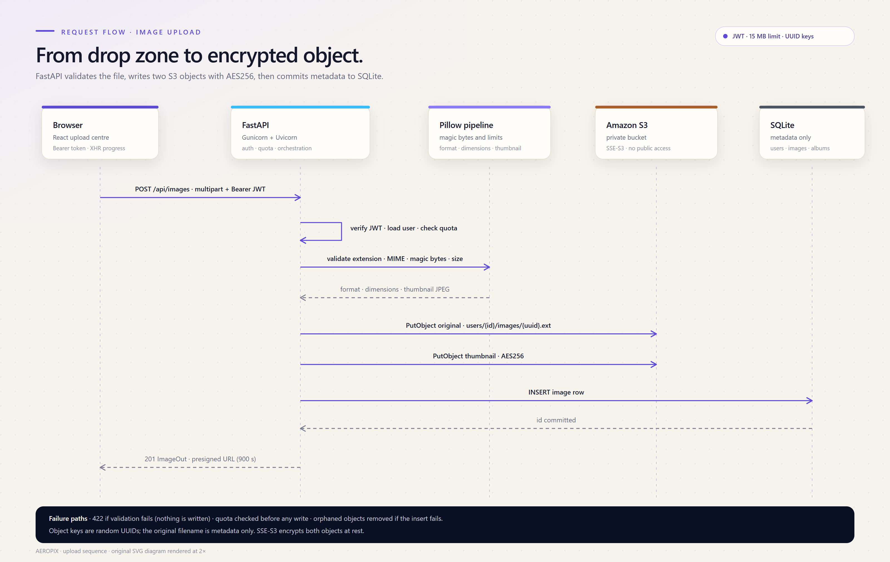

*Figure 4.3 — Browser → FastAPI → Pillow → S3 → SQLite upload sequence.*

```text
Client → POST /api/images (multipart, Bearer JWT)
FastAPI → verify token → load user
        → Pillow verify + size/type checks
        → build key users/{id}/images/{uuid}.{ext}
        → storage.put(original), storage.put(thumbnail)
        → INSERT image row
        → return ImageOut with signed URL
Client → render thumbnail; invalidate gallery query
```

### Delivery

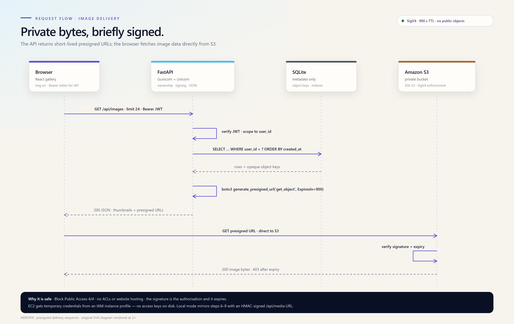

*Figure 4.4 — Presigned URL delivery: metadata from SQLite, bytes direct from S3.*

```text
GET /api/images → rows for current user → storage.url(key, 900)
Browser → GET presigned S3 URL → S3 verifies signature/expiry → bytes
```

## 4.3 Data model

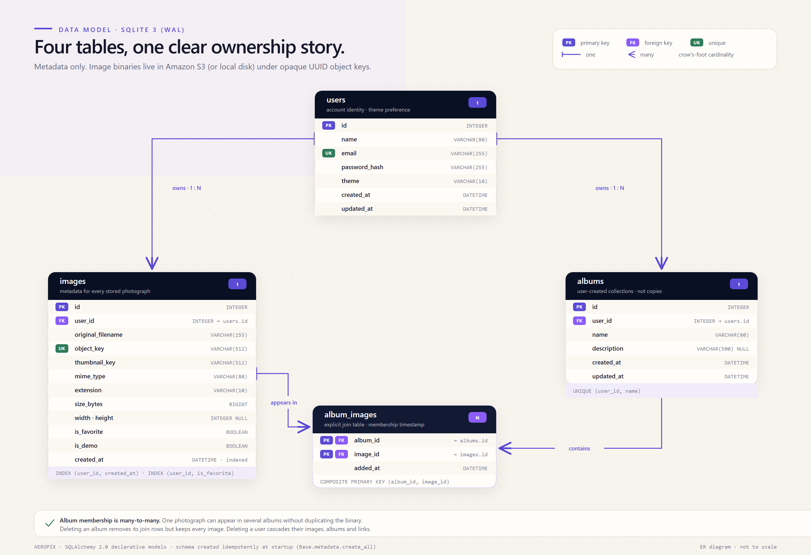

*Figure 4.2 — Four tables; binaries are not stored in the database.*

| Table | Purpose | Key constraints |
|---|---|---|
| `users` | Accounts, Argon2 hashes, theme | unique email |
| `images` | Metadata + object keys | FK user, unique object key, composite indexes |
| `albums` | User collections | unique `(user_id, name)` |
| `album_images` | Many-to-many membership + timestamp | composite PK `(album_id, image_id)` |

Full definitions are in [database-design.md](database-design.md).

## 4.4 Storage design

| Aspect | Local mode | S3 mode |
|---|---|---|
| Backend class | `LocalStorage` | `S3Storage` |
| Root | `backend/data/media` | `s3://bucket/prefix` |
| Write | atomic temp file + rename | `PutObject` with `ServerSideEncryption=AES256` |
| Read URL | `/api/media/{key}?expires&sig` | presigned HTTPS URL |
| URL lifetime | 900 s (configurable) | 900 s (configurable) |
| Integrity | HMAC-SHA256 | AWS Signature V4 |
| Health | directory writable | `HeadBucket` + latency |

## 4.5 Security design

1. **Authentication:** Argon2id hashes, HS256 JWT, 7-day expiry, production secret validation.
2. **Authorisation:** user id from the token is applied to every query; cross-user resources
   return 404.
3. **Object privacy:** Block Public Access, no ACLs, SSE-S3, no website hosting.
4. **Least privilege:** the EC2 role can list one bucket and get/put/delete its objects only.
5. **Upload safety:** extension allowlist, Pillow verification, size cap, UUID names,
   `Content-Type` from the detected format, `nosniff`.
6. **Transport:** TLS via Nginx/Certbot; HSTS in production.
7. **Browser hardening:** CSP, frame denial, referrer policy, permissions policy.
8. **Secret hygiene:** `.env` ignored; no keys in code, tests, logs or documentation.

## 4.6 Interface design

The visual language uses midnight navy (`#0A1024`), indigo/violet (`#5B4BD6`), electric blue
(`#38BDF8`), warm off-white (`#F7F4EE`) and a muted amber accent. Typography pairs Inter for
body text, Space Grotesk for headings and Fraunces for editorial accents. Glass effects are
limited to the navigation and overlays; content surfaces remain opaque for readability.

Original SVG artwork includes the logo, cloud-upload illustration, workflow illustration,
EC2/S3 diagram, empty-gallery illustration, upload-success illustration and album covers. No
emoji are used as interface icons; Lucide provides the icon set.

---

# 5. Implementation

## 5.1 Backend structure

```text
backend/app/
├── main.py                 app factory, middleware, routers, SPA fallback
├── config.py               Pydantic settings + production validators
├── database.py             engine, session factory, SQLite PRAGMAs
├── models/                 User, Image, Album, AlbumImage
├── schemas/                Pydantic request/response models
├── routers/                auth, images, albums, dashboard, system
├── services/
│   ├── auth_service.py     hashing, JWT, authentication
│   ├── image_service.py    ownership, serialisation, orchestration
│   └── storage/            base, local, s3, factory
├── utils/                  validators, thumbnails, time helpers
├── demo_art.py             procedural demo artwork
└── seed.py                 idempotent demo seeding
```

## 5.2 Authentication

Registration validates name length, email format and password strength, normalises the email,
checks uniqueness and stores an Argon2 hash. Login compares the password and returns a JWT plus
the public user object. The `get_current_user` dependency decodes the token, loads the user and
raises 401 on failure. Logout is a client-side token discard; the endpoint exists so the action
is explicit and auditable.

## 5.3 Image upload and validation

1. Extension allowlist: `jpg`, `jpeg`, `png`, `webp`, `gif`.
2. File size checked while reading, capped at 15 MB.
3. Pillow opens the stream and calls `verify()`; a second open reads dimensions.
4. Detected format must match the extension family (JPEG aliases accepted).
5. Animated GIF/WebP are accepted; thumbnails use the first frame.
6. Thumbnails are converted to RGB, stripped of metadata and saved as JPEG (max 720 px).
7. Quota is checked against `STORAGE_QUOTA_MB` before writing.
8. Storage keys use UUIDs; the original filename is sanitised for display only.

## 5.4 Gallery, search and albums

The gallery API supports `search`, `album_id`, `file_type`, `favorite`, `sort`, `limit` and
`offset`. Sorting options are newest, oldest, name A–Z/Z–A and size ascending/descending.
Search escapes SQL `LIKE` wildcards. Album membership is managed through explicit endpoints and
returns the updated album detail so the UI can refresh immediately.

Deleting an album deletes join rows only. Deleting an image deletes objects and cascades its
join rows. These rules are covered by tests.

## 5.5 Dashboard

Statistics are computed in SQL: total images, albums, favourites, bytes used, quota percentage,
uploads per day for the last 14 days, bytes by file type, largest image and recent uploads.
The frontend renders stat cards, an area chart and a donut chart with Recharts. Chart animation
is disabled when the user prefers reduced motion.

## 5.6 Frontend

* **Routing:** marketing pages (`/`, `/login`, `/register`), protected app shell (`/app`) with
  dashboard, gallery, upload, albums, album detail, image detail and settings, plus a 404.
* **Auth:** context stores the token and user; protected routes redirect to login with a return
  path; a 401 clears the session.
* **Data:** TanStack Query keys for images, albums, dashboard and storage status; mutations
  invalidate affected keys.
* **Uploads:** a queue with per-file state (`queued`, `uploading`, `success`, `error`), XHR
  progress, retry and cancel. Files are validated before the request for fast feedback.
* **Theme:** light/dark/system, persisted locally and on the profile, applied pre-paint by
  `theme-init.js`.
* **Motion:** Framer Motion for entrances and overlays, honouring reduced motion.
* **Styling:** seven CSS files organised by concern; responsive breakpoints at 1200, 1024, 860,
  640 and 420 px.

## 5.7 Demo data

Because AI image generation was unavailable and stock photographs would create licensing
questions, the project generates **eight original abstract artworks procedurally** with Pillow
(`demo_art.py`). They are seeded with `is_demo = true`, displayed with a DEMO badge, and can be
removed with `python -m app.seed --reset`. This keeps the demo honest and self-contained.

## 5.8 Screenshots

| | |
|---|---|
| 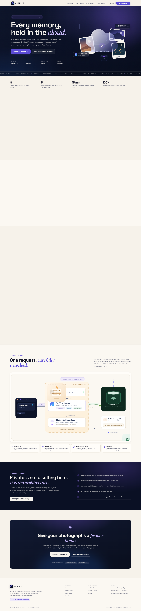 | 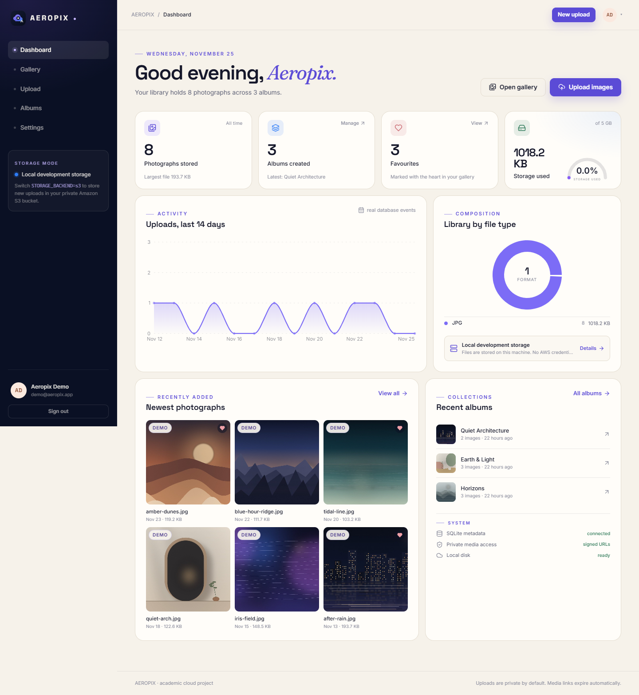 |
| *Figure 5.1 — Landing page* | *Figure 5.2 — Dashboard* |
| 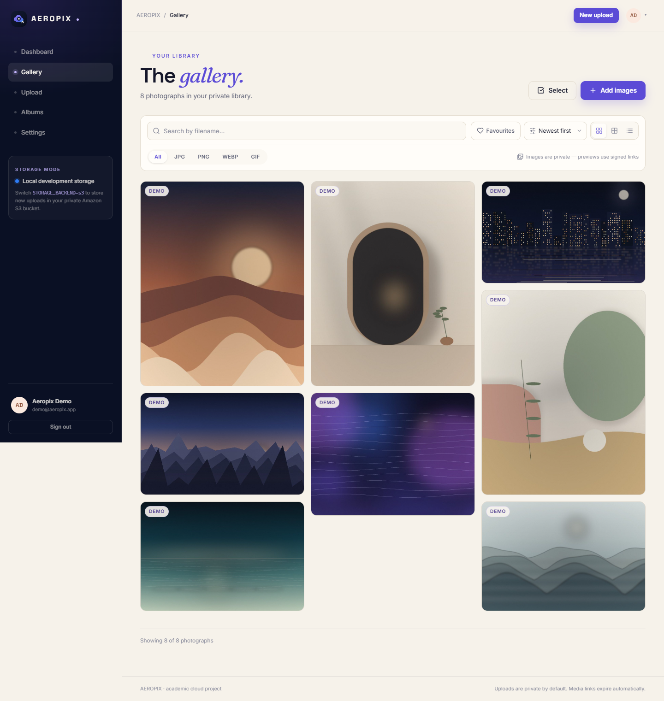 | 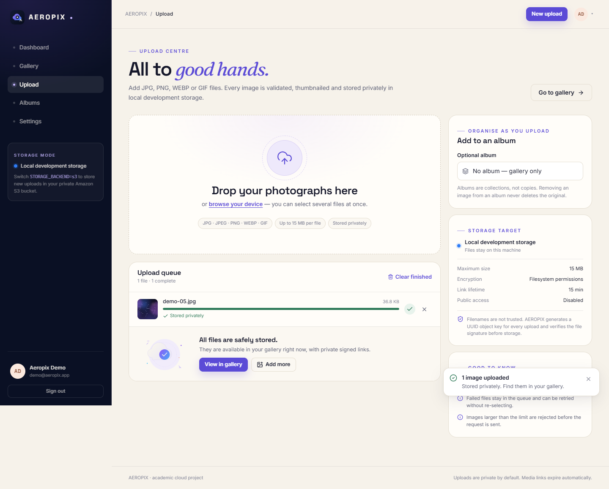 |
| *Figure 5.3 — Masonry gallery* | *Figure 5.4 — Upload centre* |
| 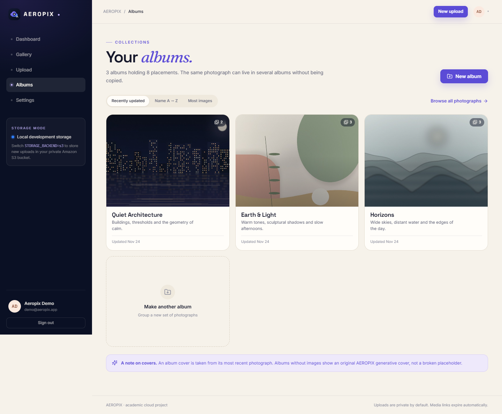 | 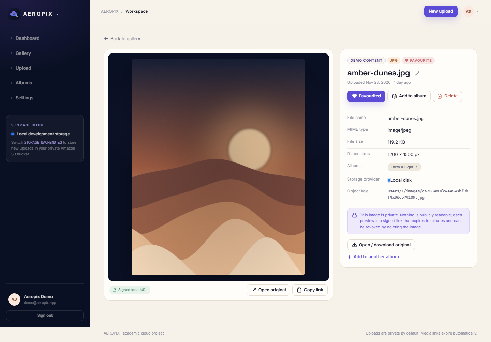 |
| *Figure 5.5 — Albums* | *Figure 5.6 — Image detail* |
| 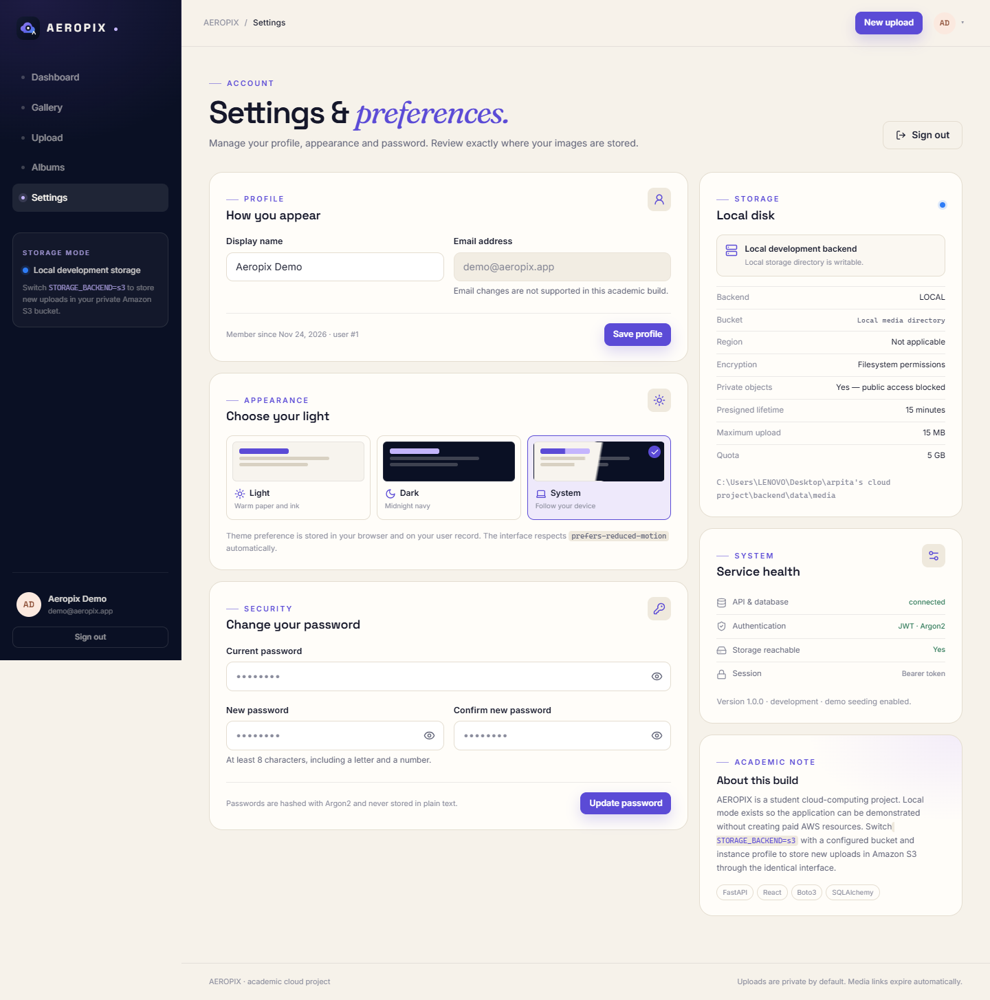 | 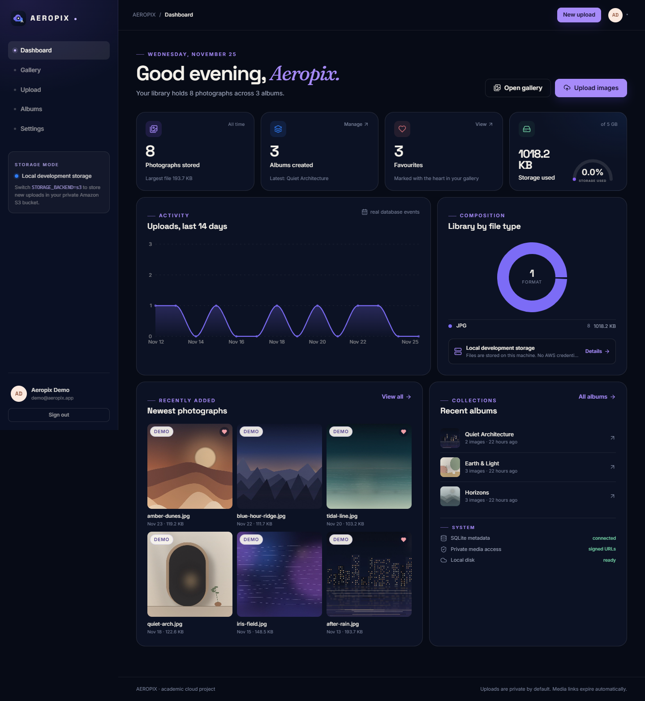 |
| *Figure 5.7 — Settings* | *Figure 5.8 — Dark theme* |

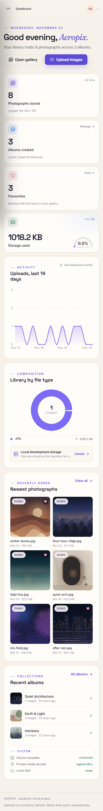

*Figure 5.9 — Mobile layout at 390 px.*

All screenshots are genuine captures of the production build. They show the **local storage
backend**, not AWS.

---

# 6. Cloud deployment design

## 6.1 Resources

| Resource | Configuration | Purpose |
|---|---|---|
| S3 bucket | Private, Block Public Access (4/4), SSE-S3, versioning recommended | Image objects |
| IAM role | `AEROPIX-EC2-S3-Role`, EC2 trust policy | Temporary credentials |
| Instance profile | `AEROPIX-EC2-Instance-Profile` | Attached to EC2 |
| EC2 instance | Ubuntu 24.04, `t3.small`, 20 GB gp3 | Application server |
| Security group | Inbound 22 (your IP), 80, 443; no 8000 | Network access |
| Elastic IP | Associated with the instance | Stable DNS target |
| Route 53 / DNS | A record to the Elastic IP | Domain name |
| TLS certificate | Let's Encrypt via Certbot | HTTPS |

## 6.2 IAM permissions

| Action | Resource | Reason |
|---|---|---|
| `s3:ListBucket` | bucket ARN | health check |
| `s3:GetBucketLocation` | bucket ARN | confirm region |
| `s3:GetObject` | bucket/* | read object if needed |
| `s3:PutObject` | bucket/* | upload originals/thumbnails |
| `s3:DeleteObject` | bucket/* | delete on user request |

No `s3:*`, no other buckets, no IAM/EC2/KMS permissions. SSE-S3 needs no KMS grant.

## 6.3 Network and process layout

```text
Internet
  │ 80/443
  ▼
Nginx (public)
  ├── /            → /opt/aeropix/frontend/dist (SPA fallback)
  └── /api/*       → 127.0.0.1:8000
                        │
                     Gunicorn + Uvicorn (systemd, user aeropix)
                        ├── SQLite /opt/aeropix/backend/data/aeropix.db
                        └── Boto3 → S3 (HTTPS, instance role)
```

Port 8000 is bound to loopback and never opened in the security group.

## 6.4 Environment configuration

Production `.env` (created by the deployment script, mode 600):

```dotenv
ENVIRONMENT=production
SECRET_KEY=<random 64-character value>
DATABASE_URL=sqlite:////opt/aeropix/backend/data/aeropix.db
STORAGE_BACKEND=s3
AWS_REGION=ap-south-1
AWS_BUCKET_NAME=your-private-bucket
S3_PRESIGN_EXPIRE_SECONDS=900
FRONTEND_DIST=/opt/aeropix/frontend/dist
```

The application refuses to start in production with the default development secret, and
refuses S3 mode without a bucket name.

## 6.5 Deployment steps (summary)

1. Create the private bucket and configure encryption/Block Public Access.
2. Create the IAM role and instance profile from `infrastructure/iam/`.
3. Launch Ubuntu 24.04 EC2 with the profile and security group; associate an Elastic IP.
4. Build the frontend locally (`npm run build`) and copy the repository to the instance.
5. Run `sudo bash scripts/deploy_ec2.sh --domain your.domain --seed --verify-s3`.
6. Point DNS at the Elastic IP; run Certbot for TLS.
7. Verify with `scripts/verify_deployment.sh` and capture AWS console evidence.
8. Tear down with `scripts/cleanup_aws.sh` after the viva.

The complete beginner-friendly walkthrough is in [aws-setup.md](aws-setup.md); operations are
in [deployment.md](deployment.md).

## 6.6 Cost considerations

A short demo on `t3.small` plus a few megabytes in S3 typically costs well under US$1 if
resources are removed the same day, but **prices and free-tier eligibility change**. The
student must check the current AWS pricing page and set a billing alarm. The project never
creates resources automatically.

---

# 7. Testing and validation

## 7.1 Strategy

| Level | Tool | Scope |
|---|---|---|
| Unit/integration | pytest + httpx | API, auth, ownership, validation, albums, dashboard |
| Storage integration | moto[S3] | Real Boto3 calls against an in-process S3 mock |
| End-to-end (local) | Playwright-core + Chrome | Production build, login, gallery, upload, themes |
| Manual | Browser | Visual quality, responsiveness, accessibility |

## 7.2 Automated backend tests

Command:

```bash
cd backend
..\.venv\Scripts\python.exe -m pytest -q
```

Verified result on 25 November 2026:

```text
..................................                                       [100%]
34 passed in 17.04s
```

| Group | Tests | Examples |
|---|---|---|
| Authentication | 7 | registration hashing, duplicate email, password strength, login, protected route, profile, password change |
| Images | 11 | valid PNG upload + signed URL, tampered signature, invalid type, extension mismatch, corrupt file, size limit, auth required, search/sort/filter, favourite/rename, delete removes object, ownership isolation, bulk delete |
| Albums | 5 | CRUD, add/remove + cover, delete keeps images, ownership isolation, cannot add another user's image |
| Dashboard | 3 | statistics, user scoping, storage status |
| Storage | 7 | S3 round trip, key prefix, S3 health, backend switching, local URL expiry/tampering, end-to-end upload to mocked S3 |
| System | 1 | health endpoint |

`moto` is an AWS mock. These tests prove the Boto3 integration logic, **not** a live AWS
deployment.

## 7.3 Browser verification

`frontend/scripts/capture-screenshots.mjs` drives the production build with real Chrome:

```text
17/17 checks passed
0 console errors
18 screenshots saved
```

Checks include landing hero, hero illustration, 404, demo login, four dashboard stat cards,
two Recharts surfaces, no broken images, eight gallery cards, lightbox, a real upload through
the UI, cleanup of that upload, three albums, album detail, image detail, settings, dark theme
and zero console errors.

## 7.4 Security-focused checks

| Check | Expected | Result |
|---|---|---|
| `/api/images` without token | 401 | Pass |
| Local media URL with altered signature | 403 | Pass |
| Local media URL after expiry | 403 | Pass (unit test) |
| Cross-user image detail | 404 | Pass |
| Cross-user album access | 404 | Pass |
| Invalid file type / corrupt image | 422 | Pass |
| Oversized upload | 413 | Pass |
| S3 object readable without signature | 403 | Covered by `moto`/policy design; live check pending AWS |

## 7.5 Requirements traceability

| Requirement | Evidence |
|---|---|
| FR-01–03 | `test_auth.py` (7 tests), login/register screenshots |
| FR-04–06 | `test_images.py`, upload screenshot, browser upload check |
| FR-07–10 | Gallery screenshots, `test_gallery_search_sort_and_type_filter`, `test_favorite_and_rename` |
| FR-11–13 | `test_albums.py` (5 tests), album screenshots |
| FR-14 | `test_dashboard.py`, dashboard screenshot |
| FR-15 | Dark theme screenshot, theme tests in browser script |
| FR-16–17 | `test_storage.py` (7 tests), architecture diagram |
| FR-18 | `test_health_endpoint`, storage status test |
| FR-19 | 404 screenshot |
| NFR-01 | Mobile screenshot |
| NFR-03–06 | Security tests + code review; live AWS policy check pending |

## 7.6 Limitations

* No live AWS deployment; S3 is tested with `moto`.
* Browser checks run in Chrome only; Firefox/Safari were not automated.
* No load, soak or penetration testing.
* No automated accessibility audit (axe/Lighthouse); manual keyboard checks only.
* SQLite single-writer limits concurrency by design.
* AWS console screenshots cannot be produced until the student deploys.

---

# 8. Results and discussion

## 8.1 Functional results

The application meets its functional objectives in local mode:

* registration, login, logout, profile edit and password change work;
* multi-file upload validates and stores real images, generates thumbnails and reports progress;
* the gallery supports three layouts, search, filters, sorting, lightbox and detail pages;
* albums support create/rename/delete and membership without duplicating binaries;
* favourites, rename, download and delete work;
* the dashboard reflects real database statistics;
* themes and responsive layouts work;
* the storage abstraction switches between local and S3 through configuration.

## 8.2 Quality observations

* The backend test suite completed in 17.04 s, fast enough for iterative development.
* Browser verification produced zero console errors and no broken images.
* The production build is served with hashed assets and long-lived caching.
* The UI avoids template patterns: custom typography, original illustrations, a restrained
  palette and selective glass.

## 8.3 Cloud readiness

The S3 implementation is complete: client construction, SSE, presigned URLs, health checks,
key prefixes and deletion. The IAM policy is scoped to one bucket and five actions. The
deployment scripts configure Nginx, systemd, permissions and verification. What remains is
execution against a real AWS account, which requires credentials the development environment
did not have.

## 8.4 Threats to validity

* Mocked S3 cannot reproduce AWS IAM evaluation, bucket policy edge cases, clock skew or
  network latency.
* Screenshots prove the local build, not the EC2 deployment.
* The absence of load testing means performance claims are qualitative.

These limitations are stated rather than hidden. The final checklist requires the student to
add genuine AWS evidence after deployment.

---

# 9. Conclusion and future work

## 9.1 Conclusion

AEROPIX demonstrates a realistic cloud storage architecture rather than a simulated one:
private S3 objects, presigned access, least-privilege IAM, metadata/binary separation and a
deployable Nginx + Gunicorn stack. The application is complete, tested and documented, with a
polished interface and an honest evidence trail. The local fallback makes the project
demonstrable without an AWS bill while preserving the exact S3 code path used in production.

## 9.2 Future work

1. PostgreSQL/RDS and multiple Gunicorn workers for concurrency.
2. Alembic migrations.
3. CloudFront with signed URLs or cookies for global delivery.
4. Rate limiting and account lockout.
5. Refresh tokens in `HttpOnly` cookies; optional MFA.
6. Image editing, EXIF display and map view.
7. Sharing links with scoped permissions and expiry.
8. Background workers for thumbnailing and virus scanning.
9. S3 lifecycle rules and intelligent tiering.
10. Infrastructure as Code (Terraform) and CI/CD with GitHub Actions.
11. Automated accessibility and cross-browser tests.
12. Observability: structured logs, metrics, alarms.

---

## References

1. Amazon Web Services, *Amazon S3 User Guide* — Bucket policies, Block Public Access,
   presigned URLs, server-side encryption.
2. Amazon Web Services, *Amazon EC2 User Guide* — Instance profiles and IAM roles for EC2.
3. Amazon Web Services, *AWS Identity and Access Management User Guide* — Least-privilege
   policies.
4. S. Ramirez, *FastAPI Documentation*, https://fastapi.tiangolo.com.
5. SQLAlchemy, *SQLAlchemy 2.0 Documentation*, https://docs.sqlalchemy.org.
6. Pydantic, *Pydantic v2 Documentation*, https://docs.pydantic.dev.
7. React, *React Documentation*, https://react.dev.
8. TanStack, *TanStack Query Documentation*, https://tanstack.com/query.
9. Boto3, *Boto3 Documentation*, https://boto3.amazonaws.com/v1/documentation/api/latest/.
10. Python Pillow, *Pillow Documentation*, https://pillow.readthedocs.io.
11. OWASP Foundation, *OWASP Top 10* and *Content Security Policy Cheat Sheet*.
12. Nginx, *Nginx Documentation*, https://nginx.org/en/docs/.
13. Let's Encrypt, *Certbot Documentation*, https://certbot.eff.org.
14. Mermaid, *Diagramming and charting tool*, https://mermaid.js.org.

---

## Appendix A — API endpoints

All endpoints are under `/api`. Protected routes require `Authorization: Bearer <token>`.

| Method | Path | Auth | Purpose |
|---|---|---|---|
| GET | `/health` | No | App, database and storage status |
| GET | `/storage/status` | Yes | Backend, bucket, encryption, quota |
| GET | `/media/{key}` | Signed URL | Local-mode media delivery |
| POST | `/auth/register` | No | Create account |
| POST | `/auth/login` | No | Obtain JWT |
| GET | `/auth/me` | Yes | Current profile |
| PATCH | `/auth/me` | Yes | Update name/theme |
| POST | `/auth/change-password` | Yes | Change password |
| POST | `/auth/logout` | Yes | Explicit logout acknowledgement |
| GET | `/images` | Yes | List/search/filter/sort |
| POST | `/images` | Yes | Upload one image |
| GET | `/images/{id}` | Yes | Image detail |
| PATCH | `/images/{id}` | Yes | Rename / favourite |
| DELETE | `/images/{id}` | Yes | Delete metadata + objects |
| POST | `/images/bulk-delete` | Yes | Delete several images |
| GET | `/albums` | Yes | List albums |
| POST | `/albums` | Yes | Create album |
| GET | `/albums/{id}` | Yes | Album detail |
| PATCH | `/albums/{id}` | Yes | Rename/describe |
| DELETE | `/albums/{id}` | Yes | Delete album, keep images |
| POST | `/albums/{id}/images` | Yes | Add images |
| DELETE | `/albums/{id}/images/{image_id}` | Yes | Remove image |
| GET | `/dashboard` | Yes | Statistics |
| GET | `/docs` | No | Swagger UI |
| GET | `/openapi.json` | No | OpenAPI schema |

## Appendix B — Environment variables

| Variable | Default | Purpose |
|---|---|---|
| `ENVIRONMENT` | `development` | `development`, `test` or `production` |
| `DEBUG` | `false` | Debug logging |
| `SECRET_KEY` | dev placeholder | JWT/HMAC signing; ≥24 chars; production rejects default |
| `ACCESS_TOKEN_EXPIRE_MINUTES` | `10080` | 7-day JWT lifetime |
| `DATABASE_URL` | `sqlite:///.../data/aeropix.db` | SQLAlchemy URL |
| `STORAGE_BACKEND` | `local` | `local` or `s3` |
| `LOCAL_STORAGE_PATH` | `backend/data/media` | Local object root |
| `LOCAL_URL_TTL_SECONDS` | `900` | Local signed URL lifetime |
| `AWS_REGION` | `ap-south-1` | Bucket region |
| `AWS_BUCKET_NAME` | empty | Required in S3 mode |
| `AWS_ACCESS_KEY_ID` / `AWS_SECRET_ACCESS_KEY` | unset | Optional local experiments only |
| `S3_KEY_PREFIX` | empty | Optional object prefix |
| `S3_PRESIGN_EXPIRE_SECONDS` | `900` | Presigned URL lifetime |
| `S3_USE_SSE` | `true` | Send AES256 on upload |
| `MAX_UPLOAD_MB` | `15` | Per-file limit |
| `STORAGE_QUOTA_MB` | `5120` | Per-user quota |
| `ALLOWED_ORIGINS` | localhost dev ports | CORS allowlist |
| `ALLOWED_HOSTS` | `*` | Trusted hosts (`*` in the academic deployment) |
| `FRONTEND_DIST` | `frontend/dist` | SPA build served by FastAPI |
| `SEED_DEMO_DATA` | `true` | Expose demo-enabled flag |
| `DEMO_EMAIL` / `DEMO_PASSWORD` | demo values | Seed credentials |

## Appendix C — Academic integrity and evidence status

**Verified in this submission**

* 34 backend tests passing in 17.04 s.
* 17 browser checks passing, 0 console errors.
* 18 genuine screenshots of the production build.
* Original architecture and ER diagrams (SVG + PNG).
* Complete deployment scripts and IAM policies, reviewed but not executed against AWS.

**Not verified / to be completed by the student**

* Live EC2 deployment and public HTTPS URL.
* Real S3 bucket evidence (Block Public Access, encryption, objects, presigned URL).
* AWS console screenshots and billing evidence.
* Certbot certificate and DNS records.

No AWS screenshot in this repository is fabricated. Any placeholder marked "pending" must be
replaced only with a genuine capture after deployment. Submitting invented cloud evidence is a
violation of academic integrity.
